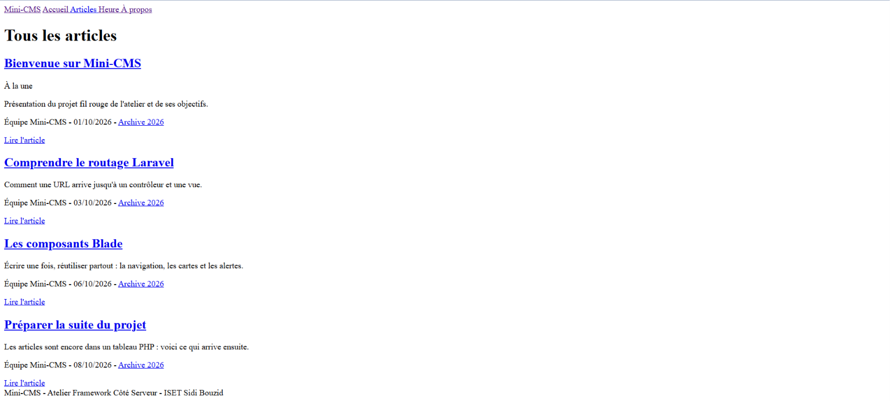
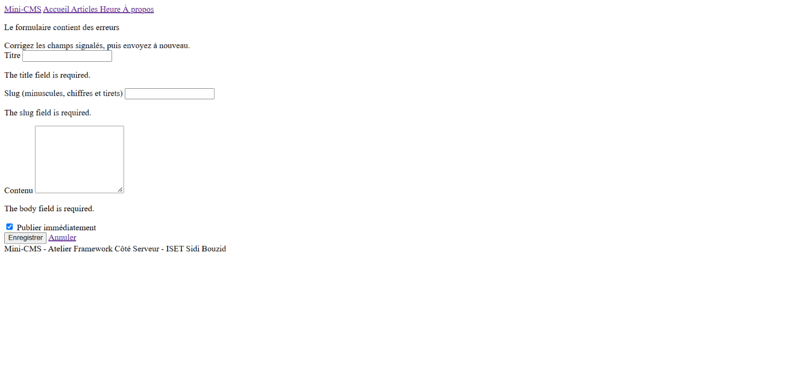
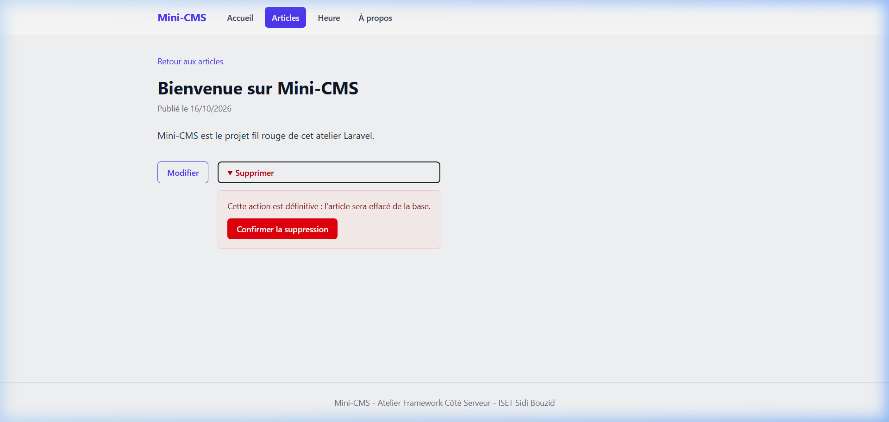
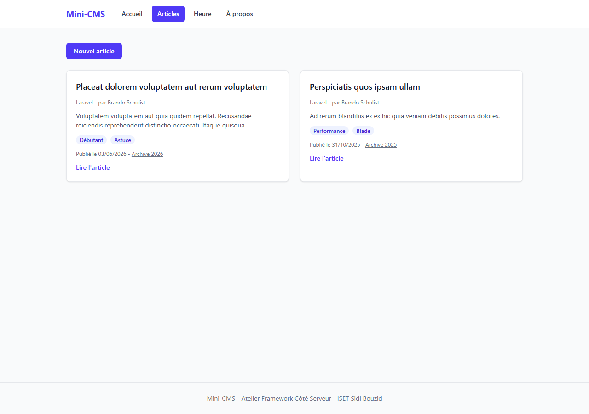
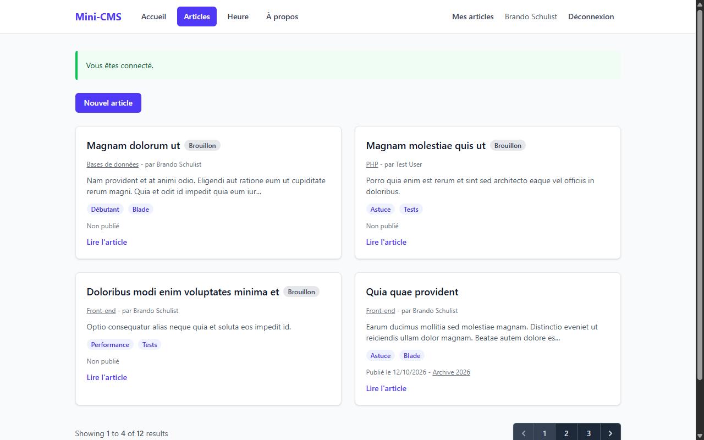

# Mini-CMS

Projet fil rouge de l'Atelier Framework Côté Serveur (Laravel 13, PHP 8.3+), 3e année MDW, ISET Sidi Bouzid.

**Auteur :** Bara Nsaibia, groupe MDW33.

Mini-CMS évoluera au fil du semestre vers une petite plateforme de publication : pages publiques, back-office authentifié, API JSON et tests Pest. Chaque session se termine par un tag Git (`lab-01`, `lab-01b`, puis un tag par session).

## État actuel (tag lab-06)

- Comptes écrits à la main : inscription (`/inscription`), connexion (`/connexion`) et déconnexion, avec `Hash::make`, `Auth::attempt` et la régénération de la session.
- Colonne `role` (`author` par défaut, `admin`). Après `php artisan migrate:fresh --seed`, le compte de démonstration `test@example.com` (mot de passe `password`) est administrateur.
- Écritures et back-office réservés aux utilisateurs connectés (middleware `auth`) ; chaque nouvel article est attaché à son auteur.
- Gate `manage-categories` : seuls les administrateurs gèrent les catégories.
- `PostPolicy` : un auteur modifie et supprime ses articles, un administrateur tous les articles.
- Tests Pest : `PostPagesTest`, `PostWriteTest`, `PostRelationsTest`, `PostTaxonomyTest`, `PostFeedbackTest`, `CategoryAdminTest`, `ErrorPagesTest`, `AuthTest` et `AuthorizationTest`.

## Données de démonstration

Après un clone, reconstruire la base avec `php artisan migrate:fresh --seed`. Attention : cette commande vide la base avant de la remplir.

## Routes disponibles

| Méthode | URI | Nom | Action |
|---|---|---|---|
| GET | `/` | `home` | `PageController@home` |
| GET | `/a-propos` | `about` | `PageController@about` |
| GET | `/heure` | `time` | `PageController@time` |
| GET | `/posts` | `posts.index` | `PostController@index` |
| GET | `/posts/archive/{year}` | `posts.archive` | `PostController@archive` |
| GET | `/posts/categorie/{category:slug}` | `posts.category` | `PostController@byCategory` |
| GET | `/posts/tag/{tag:slug}` | `posts.tag` | `PostController@byTag` |
| GET | `/posts/create` | `posts.create` | `PostController@create` |
| POST | `/posts` | `posts.store` | `PostController@store` |
| GET | `/posts/{post}` | `posts.show` | `PostController@show` |
| GET | `/posts/{post}/edit` | `posts.edit` | `PostController@edit` |
| PUT | `/posts/{post}` | `posts.update` | `PostController@update` |
| DELETE | `/posts/{post}` | `posts.destroy` | `PostController@destroy` |
| PATCH | `/posts/{post}/publication` | `posts.publication` | `PostController@togglePublication` |
| GET | `/admin/categories` | `admin.categories.index` | `CategoryController@index` |
| GET | `/admin/categories/create` | `admin.categories.create` | `CategoryController@create` |
| POST | `/admin/categories` | `admin.categories.store` | `CategoryController@store` |
| GET | `/admin/categories/{category}/edit` | `admin.categories.edit` | `CategoryController@edit` |
| PUT | `/admin/categories/{category}` | `admin.categories.update` | `CategoryController@update` |
| DELETE | `/admin/categories/{category}` | `admin.categories.destroy` | `CategoryController@destroy` |
| GET | `/admin/tags` | `admin.tags.index` | `TagController@index` |
| GET | `/admin/tags/create` | `admin.tags.create` | `TagController@create` |
| POST | `/admin/tags` | `admin.tags.store` | `TagController@store` |
| GET | `/admin/tags/{tag}/edit` | `admin.tags.edit` | `TagController@edit` |
| PUT | `/admin/tags/{tag}` | `admin.tags.update` | `TagController@update` |
| DELETE | `/admin/tags/{tag}` | `admin.tags.destroy` | `TagController@destroy` |
| GET | `/inscription` | `register` | `Auth\RegisterController@create` |
| POST | `/inscription` | `register.store` | `Auth\RegisterController@store` |
| GET | `/connexion` | `login` | `Auth\LoginController@create` |
| POST | `/connexion` | `login.store` | `Auth\LoginController@store` |
| POST | `/deconnexion` | `logout` | `Auth\LoginController@destroy` |

## Prérequis

-   PHP 8.3 ou plus, avec les extensions `curl`, `fileinfo`, `mbstring`, `openssl`, `pdo_sqlite`, `sqlite3` et `zip`.
-   [Composer](https://getcomposer.org/).
-   Node.js LTS et npm.
-   Git.

Téléchargement de PHP : [php.net/downloads](https://www.php.net/downloads).

## Installation

### Bash (Git Bash, macOS, Linux)

```bash
git clone https://github.com/BaraNsaibia/mini-cms.git
cd mini-cms
composer install
npm install
cp .env.example .env
php artisan key:generate
touch database/database.sqlite
php artisan migrate
composer run dev
```

### PowerShell (Windows)

```powershell
git clone https://github.com/BaraNsaibia/mini-cms.git
cd mini-cms
composer install
npm install
Copy-Item .env.example .env
php artisan key:generate
New-Item database/database.sqlite -ItemType File
php artisan migrate
composer run dev
```

Ouvrir ensuite [http://localhost:8000](http://localhost:8000). L'application utilise le port 8000 ; Vite utilise généralement le port 5173.

## Captures d'écran

### Accueil avec le layout


### Liste des articles — Session 03


### Détail d'un article


### Session 04 — Composant x-page-header



### Session 05




### Session 06




### Session 07


### Session 08




### Session 09


### Session 10

Back-office des catégories et des tags, messages de validation en français, pages 404 et 503 dans le layout du site.


### Session 11




## Comparaison avec le starter kit Livewire

| Critère | Mini-CMS (authentification manuelle) | Starter kit Livewire |
|---|---|---|
| Routes d'authentification | `routes/web.php` (`/inscription`, `/connexion`, `/deconnexion`) | Enregistrées par Fortify depuis son paquet ; absentes de `routes/web.php` |
| Inscription | `app/Http/Controllers/Auth/RegisterController.php` et `resources/views/auth/register.blade.php` | `app/Actions/Fortify/CreateNewUser.php` (`Validator::make` puis `User::create`) et `resources/views/pages/auth/register.blade.php` |
| Connexion | `app/Http/Controllers/Auth/LoginController.php` (`Auth::attempt`, `regenerate`) et `resources/views/auth/login.blade.php` | Contrôleur de Fortify et `resources/views/pages/auth/login.blade.php` |
| Déconnexion | `app/Http/Controllers/Auth/LoginController.php` (`logout`, `invalidate`, `regenerateToken`) | Route `logout` de Fortify ; opérations identiques dans `app/Livewire/Actions/Logout.php` |
| Limitation des tentatives | Aucune | 5 tentatives par minute par e-mail et adresse IP (`app/Providers/FortifyServiceProvider.php`) |
| Mot de passe oublié | Absent | `Features::resetPasswords()` dans `config/fortify.php` |
| Vérification de l'e-mail | Absente | `Features::emailVerification()`, `MustVerifyEmail` sur `User`, middleware `verified` sur `/dashboard` |
| Double authentification | Absente | `Features::twoFactorAuthentication()` et `Features::passkeys()` |
| Rôles et autorisations | Colonne `role`, Gates (`manage-categories`, `manage-tags`), `PostPolicy`, middleware `admin` | Aucun : à écrire soi-même |
| Tests | `AuthTest`, `AuthorizationTest`, `AdminAccessTest`, `PostVisibilityTest` | 10 fichiers dans `tests/Feature` (Auth, Settings, Dashboard) |

Ce que je garderais du kit dans un vrai projet : Le kit prend en charge des aspects de sécurité complexes et indispensables en production, comme la limitation des tentatives de connexion, la réinitialisation de mot de passe et l'authentification à deux facteurs. En revanche, pour la gestion des accès métier, je conserverais une architecture claire et sur-mesure basée sur des Gates et des Policies comme développée dans Mini-CMS.
