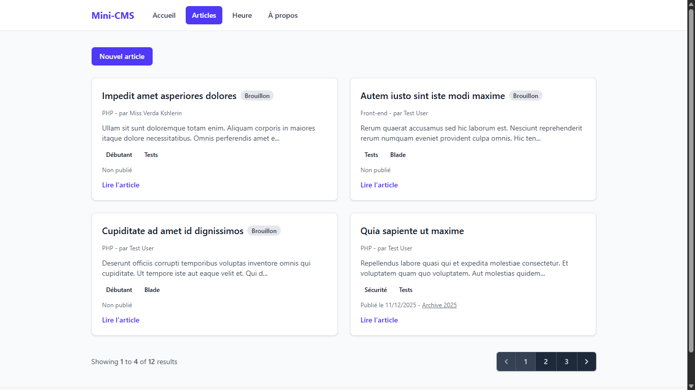
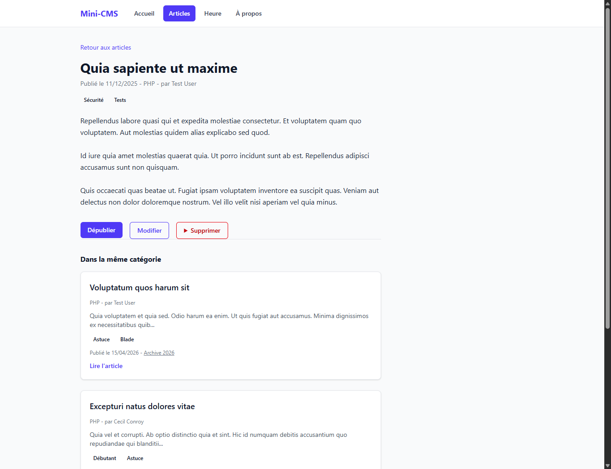

# Mini-CMS

Projet fil rouge de l'Atelier Framework Côté Serveur (Laravel 13, PHP 8.3+), 3e année MDW, ISET Sidi Bouzid.

Auteur : Bara Nsaibia, groupe MDW33.

Mini-CMS évoluera au fil du semestre vers une petite plateforme de publication : pages publiques, back-office authentifié, API JSON et tests Pest. Chaque session se termine par un tag Git (`lab-01`, `lab-01b`, puis un tag par session).

## État actuel (tag lab-04)

- Modèles `Category` et `Tag` reliés à `Post` : un article a une catégorie et un auteur (1:N) et plusieurs tags (N:N, table pivot `post_tag`).
- Fabriques `PostFactory` (état `published()`), `CategoryFactory`, `TagFactory` et seeders pour un jeu de données réaliste.
- Chargement anticipé avec `with()` ; `Model::preventLazyLoading()` signale tout problème N+1 hors production.
- Tests Pest : `PostPagesTest`, `PostWriteTest` et `PostRelationsTest`.

## Données de démonstration

Après un clone, reconstruire la base avec `php artisan migrate:fresh --seed`. Attention : cette commande vide la base avant de la remplir.

## Routes disponibles

| Méthode | URI | Réponse |
|---|---|---|
| GET | `/a-propos` | Vue `a-propos` avec le nom de l'auteur et le groupe |

## Prérequis

-   PHP et Composer (PHP 8.3 ou plus depuis https://www.php.net/downloads, avec les extensions curl, fileinfo, mbstring, openssl, pdo_sqlite, sqlite3 et zip activées dans php.ini, et Composer depuis https://getcomposer.org).
-   Node.js LTS et npm.
-   Git.

## Installation

### Bash (Git Bash, macOS, Linux)

```bash
git clone https://github.com/BaraNsaibia/mini-cms.git
cd mini-cms
composer install
npm install
cp .env.example .env
php artisan key:generate
touch database/database.sqlite
php artisan migrate
composer run dev
```

### PowerShell (Windows)

```powershell
git clone https://github.com/BaraNsaibia/mini-cms.git
cd mini-cms
composer install
npm install
copy .env.example .env
php artisan key:generate
New-Item database\database.sqlite -ItemType File
php artisan migrate
composer run dev
```

Ouvrir ensuite http://localhost:8000 (adresse de l'application, différente de l'adresse de Vite sur le port 5173).

## Captures d'écran

### Page d'accueil


### Page Bienvenue


### Liste des routes


### Page À propos


### Session 07




