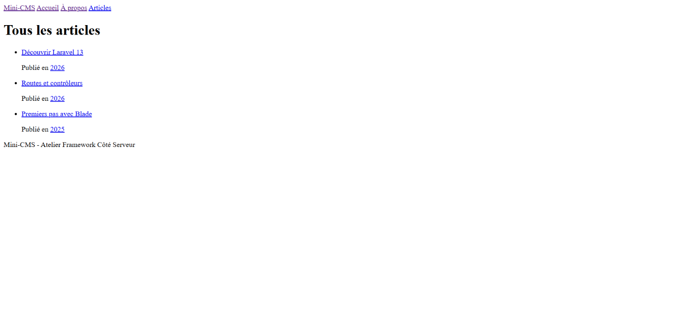
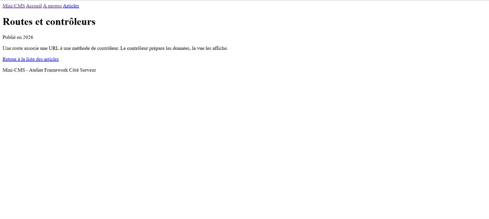
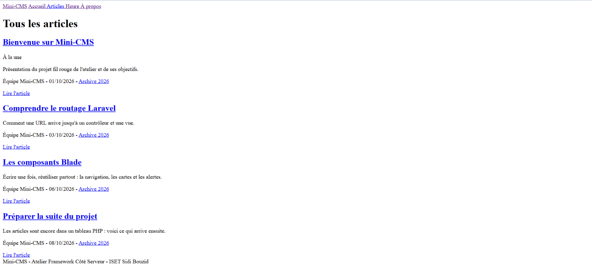

# Mini-CMS

Projet fil rouge de l'Atelier Framework Côté Serveur (Laravel 13, PHP 8.3+), 3e année MDW, ISET Sidi Bouzid.

**Auteur :** Bara Nsaibia, groupe MDW33.

Mini-CMS évoluera au fil du semestre vers une petite plateforme de publication : pages publiques, back-office authentifié, API JSON et tests Pest. Chaque session se termine par un tag Git (`lab-01`, `lab-01b`, puis un tag par session).

## État actuel (tag lab-02b)

-   Pages construites avec des composants Blade anonymes : `x-navbar`, `x-nav-link`, `x-post-card`, `x-alert`, `x-page-header`.
-   Lien actif dans la navigation avec `request()->routeIs()`.
-   Articles toujours stockés dans un tableau PHP, sans base de données pour l'instant.

## Routes disponibles

| Méthode | URI                     | Nom             | Action                   |
| ------- | ----------------------- | --------------- | ------------------------ |
| GET     | `/`                     | `home`          | `PageController@home`    |
| GET     | `/a-propos`             | `about`         | `PageController@about`   |
| GET     | `/heure`                | `time`          | `PageController@time`    |
| GET     | `/posts`                | `posts.index`   | `PostController@index`   |
| GET     | `/posts/archive/{year}` | `posts.archive` | `PostController@archive` |
| GET     | `/posts/{slug}`         | `posts.show`    | `PostController@show`    |

## Prérequis

-   PHP 8.3 ou plus, avec les extensions `curl`, `fileinfo`, `mbstring`, `openssl`, `pdo_sqlite`, `sqlite3` et `zip`.
-   [Composer](https://getcomposer.org/).
-   Node.js LTS et npm.
-   Git.

Téléchargement de PHP : [php.net/downloads](https://www.php.net/downloads).

## Installation

### Bash (Git Bash, macOS, Linux)

```bash
git clone https://github.com/BaraNsaibia/mini-cms.git
cd mini-cms
composer install
npm install
cp .env.example .env
php artisan key:generate
touch database/database.sqlite
php artisan migrate
composer run dev
```

### PowerShell (Windows)

```powershell
git clone https://github.com/BaraNsaibia/mini-cms.git
cd mini-cms
composer install
npm install
Copy-Item .env.example .env
php artisan key:generate
New-Item database/database.sqlite -ItemType File
php artisan migrate
composer run dev
```

Ouvrir ensuite [http://localhost:8000](http://localhost:8000). L'application utilise le port 8000 ; Vite utilise généralement le port 5173.

## Captures d'écran

### Accueil avec le layout


### Liste des articles — Session 03



### Détail d'un article



### Session 04 — Composant x-page-header


